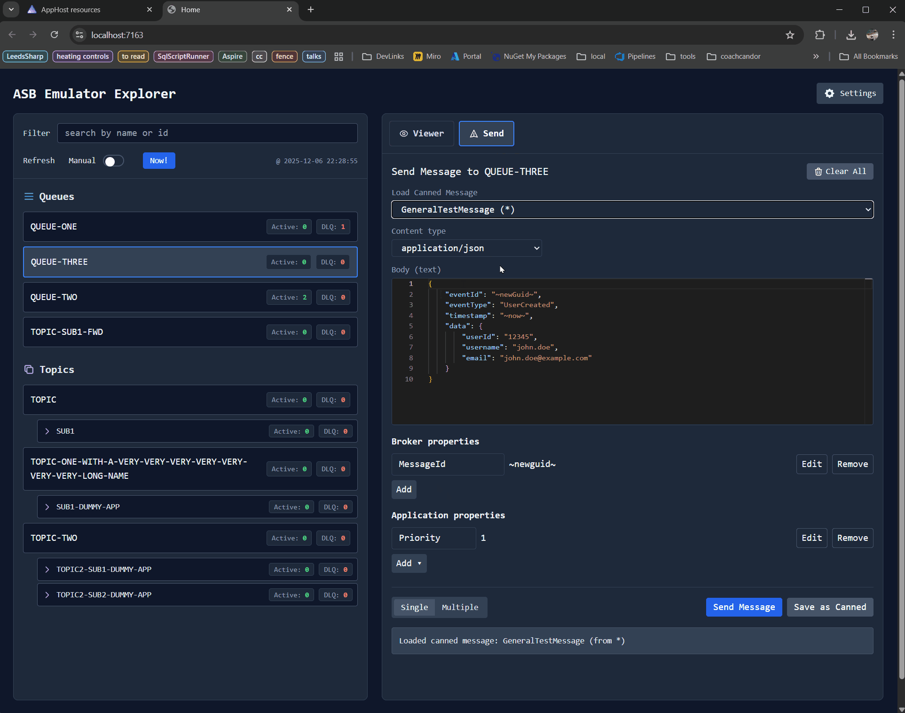

  

# Azure Service Bus Emulator UI

A Blazor-based web UI for exploring and testing Azure Service Bus entities in the [Azure Service Bus Emulator](https://learn.microsoft.com/azure/service-bus-messaging/test-locally-with-service-bus-emulator) especially although not exclusively in Aspire.

Basically postman for the ASB emulator!



## Features

### 🔍 Entity Explorer
- View all **queues** and **topics** from your ASB emulator
- Real-time message counts (Active & Dead-Letter Queue)
- Auto-refresh mode with manual override
- Filter entities by name or ID

### 📨 Message Sender
- Send messages to queues or topics
- **Monaco Editor** with syntax highlighting for JSON, XML, plain text
- Configure broker properties (MessageId, CorrelationId, SessionId, TTL, ScheduledEnqueueTime, etc.)
- **Session ID**: set `SessionId` in **Broker properties**. For known session-enabled targets, **Set Session ID** opens the existing property editor with SessionId selected. Enter an ID or use **+** to generate a GUID, then **Save**. Reuse an ID to group messages; literal IDs are shared by a batch, while explicit placeholders keep their per-message behavior.
- Session-enabled queues show requirement guidance when management metadata is available; topics warn about known session-enabled subscriptions. Aspire supplies the emulator management endpoint when available. For standalone use, set `ASB_MANAGEMENT_ENDPOINT` to its HTTP management URL (port 5300 inside the emulator, not its AMQP port), or provide `ASB_MANAGEMENT_CONNECTIONSTRING`. Detection is best-effort: unavailable metadata leaves the requirement unknown, but the broker still enforces it.
- Configure application properties
- **Placeholder syntax** for dynamic test data
- **Canned Messages** library:
  - Save frequently used messages
  - Organize by category
  - **AI Generation**: Generate message templates using AI (requires an LLM)
- **Quick Values** clipboard helper (new GUIDs, timestamps)

### 👀 Message Viewer
- Select **Peek | Receive | Clear**, then use the single **Go** action. Switching mode does not start an operation.
- Monaco Editor for message body viewing
- Display broker and application properties
- **Clear**: the tooltip identifies Main, DLQ or session scope, and an in-app confirmation names the target before draining currently available messages from the selected queue or subscription. For DLQ messages already received by this viewer, Clear completes those retained locks first, then drains currently available messages. Switching between Receive and Clear on the same DLQ preserves those locks until confirmation; cancelling does not settle them. Clearing stops after 10,000 messages, 30 seconds, or an empty receive; messages locked elsewhere, scheduled and deferred may remain. Cancellation cannot restore messages already deleted.
- **Session scope**: one dropdown offers **AllSessions | NextAvailableSession | SpecificSession** for session-enabled Main entities. AllSessions is hidden in Receive mode. SpecificSession shows one input; IDs are case-sensitive. NextAvailableSession displays the actual selected ID after Peek or Receive. Ordinary entities and DLQs use ordinary receivers; when metadata is unknown, explicitly enable session handling if appropriate.
- **Session Clear**: AllSessions drains available sessions under one global 10,000-message/30-second limit; NextAvailableSession or SpecificSession drains one session. The confirmation states the scope. Locked, scheduled or deferred messages can remain, and repeated session selection stops clearing rather than looping indefinitely.
- **Session Peek**: AllSessions and SpecificSession use non-locking paginated inspection. NextAvailableSession briefly accepts a PeekLock session while inspecting its messages, then releases it without receiving/deleting messages. All peeks scan at most 10,000 messages or 30 seconds; limited/cancelled/error results are marked potentially incomplete.
- **Receive locks messages**: Go receives directly unless it would replace a batch with unsettled or uncertain locks. Replacing such a batch opens a confirmation explaining lock/redelivery consequences; Cancel preserves the current batch. Clear always requires confirmation. Received Main rows offer **Dead-Letter** and **Complete** against their original lock/receiver; DLQ rows offer **Replay** and **Complete**. Per-message actions run without repeated modal confirmations; successfully replayed rows show **Replayed**, while settled Main rows show **Completed** or **DeadLettered** with actions disabled. No other messages are received or abandoned when clicking settlement actions.
- **DLQ Replay**: clicking Replay directly sends a new copy to the main queue—or the parent topic for a subscription DLQ—then completes the original only after confirmed send. Replay preserves raw body, typed application properties, SessionId and writable message properties, uses a fresh MessageId and removes old scheduling/dead-letter diagnostics. Topic replay can reach every matching subscription. Send and completion are not atomic: uncertain sends or failed completion may leave duplicates, are reported separately and are never automatically retried.
- Received rows show settlement state, delivery count and lock expiry. Locks are not renewed; expired or uncertain handles cannot be retried. Reloading, switching context, disconnecting or leaving the page closes the receiver; unsettled locks may remain until broker expiry. Expiry/redelivery can increase delivery counts and eventually cause automatic dead-lettering.
- **Peek is inspection-only**: peeked messages have no settlement lock. Sequence-based settlement APIs reject requests without contacting the broker, avoiding unsafe receive/abandon scans. The existing programmatic `ReceiveMessagesAsync` / `ReceiveMessagesWithSessionAsync` APIs remain ReceiveAndDelete for compatibility; only the UI Receive workflow uses retained PeekLock batches. Clear remains bulk deletion.

### ⚙️ Settings Management
- **Persistence**: Settings are saved to `localStorage` and automatically loaded.
- **Import/Export**: Export settings to JSON for sharing or backup.
- Manage content types and common application properties.

## Quick Start

### Wiring up in Aspire

1.  Add the [`AJP.Aspire.Hosting.AsbEmulatorUi`](https://www.nuget.org/packages/AJP.Aspire.Hosting.AsbEmulatorUi/) package to your AppHost project.
2.  Use one of the approaches below to add the UI resource.

#### Using `WithUi()` (recommended)

The simplest way to add the UI is to chain `.WithUi()` inside `RunAsEmulator()`. This creates a hidden UI container and displays an **Explorer UI** link directly on the emulator resource in the Aspire dashboard.

```csharp
var builder = DistributedApplication.CreateBuilder(args);

var serviceBus = builder
    .AddAzureServiceBus("myservicebus")
    .RunAsEmulator(c => c.WithLifetime(ContainerLifetime.Persistent)
    .WithUi());

builder.Build().Run();
```

You can also provide canned messages or a settings override file via additional chaining:

```csharp
// WithUi() + canned messages
var serviceBus = builder
    .AddAzureServiceBus("myservicebus")
    .RunAsEmulator(c => c
        .WithLifetime(ContainerLifetime.Persistent)
        .WithUi()
        .WithCannedMessages(new Dictionary<string, Dictionary<string, CannedMessage>>
        {
            ["orders-queue"] = new()
            {
                ["OrderCreated"] = new CannedMessage
                {
                    ContentType = "application/json",
                    Body = "{\"orderId\": \"~newGuid~\", \"amount\": 99.99}",
                    ApplicationProperties = new() { ["MessageType"] = "OrderCreated" }
                }
            }
        }));

// WithUi() + settings override file
var serviceBus = builder
    .AddAzureServiceBus("myservicebus")
    .RunAsEmulator(c => c
        .WithLifetime(ContainerLifetime.Persistent)
        .WithUi()
        .WithOverridenSettingsFile("settings.json"));
```

```json
//sample settings file:
{
  "ContentTypes": [
    "application/json",
    "text/plain"
  ],
  "DefaultContentType": "application/json",
  "CommonApplicationProperties": [
    {
      "Key": "Source",
      "Value": "local-test"
    }
  ],
  "CannedMessages": {
    "queue-one": {
      "test event": {
        "ContentType": "application/json",
        "Body": "{\n  \"eventId\": \"~newGuid~\",\n  \"eventType\": \"TestEvent\",\n  \"message\": \"Hello from the Aspire ASB Emulator UI\",\n  \"createdAt\": \"~now~\"\n}",
        "BrokerProperties": {
          "MessageId": "~newGuid~",
          "CorrelationId": "~newGuid~"
        },
        "ApplicationProperties": {
          "Source": "local-test",
          "MessageType": "MT_EVENT"
        }
      },
      "plain text": {
        "ContentType": "text/plain",
        "Body": "Test message sent at ~now~.",
        "BrokerProperties": {},
        "ApplicationProperties": {
          "Source": "local-test"
        }
      }
    }
  }
}

```

Use either `WithOverridenSettingsFile()` or `WithCannedMessages()` for a UI resource, not both.

You can also export these settings from the UI.

#### Using `AddAsbEmulatorUi()` (standalone resource)

Alternatively, add the UI as a separate visible resource in the dashboard:

```csharp
var builder = DistributedApplication.CreateBuilder(args);

var serviceBus = builder
    .AddAzureServiceBus("myservicebus")
    .RunAsEmulator(c => c.WithLifetime(ContainerLifetime.Persistent));

builder.AddAsbEmulatorUi("asb-ui", serviceBus);

builder.Build().Run();
```

### Environment Variables

The application uses the following environment variables for configuration:

| Variable | Description |
|----------|-------------|
| `asb-sql-connectionstring` | Full connection string to the ASB Emulator's SQL backend. Overrides other SQL settings. |
| `asb-sql-port` | Port of the SQL server (automatically set by `AddAsbEmulatorUi`). |
| `asb-sql-password` | Password for the `sa` user (automatically set by `AddAsbEmulatorUi`). |
| `asb-emulator-sqlserver` | Hostname (and optional port) of the SQL server. Useful for custom networking setups. |
| `AsbEmulatorUi__SettingsOverride` | JSON string to override application settings (Canned Messages, etc.). |

## Placeholder Syntax

Use placeholders in message bodies for dynamic test data:

| Placeholder | Example Result |
|-------------|----------------|
| `~newGuid~` | `a1b2c3d4-e5f6-7890-abcd-ef1234567890` |
| `~now~` | `2024-01-15T10:30:00.0000000Z` |
| `~now+5m~` | 5 minutes from now |
| `~now+1h~` | 1 hour from now |
| `~now+1d~` | 1 day from now |
| `~now-5m~` | 5 minutes ago |

**Example:**
```json
{
  "orderId": "~newGuid~",
  "customerId": "~newGuid~",
  "timestamp": "~now~",
  "scheduledDelivery": "~now+5m~",
  "expiresAt": "~now+1d~"
}
```

## Important Notes

**Azure Service Bus Message Flow:**
- **Queues**: Send → Queue → Receive ✅
- **Topics**: Send → Topic → Subscriptions → Receive ✅
  - Send messages **TO topics** (not subscriptions)
  - Topics automatically distribute to subscriptions
  - Subscriptions appear beneath their parent topic in the UI
  - Topic active count may show 0 (messages are in subscriptions)

## Tech Stack
- **Blazor Interactive Server** - Real-time UI
- **Tailwind CSS** - Modern styling
- **Monaco Editor** - VS Code-powered editing
- **Azure Service Bus Client SDK** - Native ASB operations
- **.NET 10** - Latest .NET

## API

The application exposes a simple REST API for integration testing and automation.

### Send Canned Message

Triggers the sending of a pre-configured "Canned Message" to a specific entity.

```http
POST /api/canned/{entity}/{scenario}
```

| Parameter | Type | Description |
|-----------|------|-------------|
| `entity` | Route | The name of the queue or topic (e.g., `orders-queue`). |
| `scenario` | Route | The name of the canned message scenario (e.g., `OrderCreated`). |

**Response:**

```json
{
  "success": true,
  "entity": "orders-queue",
  "scenario": "OrderCreated",
  "messageId": "a1b2c3d4...",
  "sentAt": "2024-01-15T12:00:00+00:00"
}
```

This is particularly useful for triggering test scenarios from external tools or scripts.

## License
MIT License
